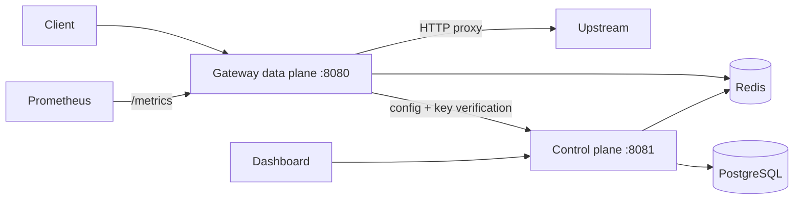

# GateKeeper

Self-hosted API gateway and management plane written in TypeScript. This repository currently provides a working foundation: configurable HTTP route proxying, a versioned control-plane configuration snapshot, API key checks, Redis fixed-window rate limits, PostgreSQL-backed services/routes/consumers, a dark operator dashboard, and Prometheus scraping.

## Start locally

Requirements: Docker Desktop with Compose v2. From the project root:

```powershell
Copy-Item .env.example .env
# Edit .env and set unique secrets/passwords before exposing the system.
docker compose up --build
```

Dashboard: http://localhost:3000 · control API: http://localhost:8081 · gateway: http://localhost:8080 · Prometheus: http://localhost:9090. Database and Redis are only on the internal Compose network. Control plane and dashboard bind to localhost in the supplied development compose file.

Bootstrap once:

```powershell
$payload = @{secret=$env:ADMIN_PASSWORD;email='admin@example.com';password='choose-a-strong-password'} | ConvertTo-Json
Invoke-RestMethod http://localhost:8081/v1/auth/bootstrap -Method Post -ContentType 'application/json' -Body $payload
```

Then sign in on the dashboard. The bootstrap secret must match `ADMIN_PASSWORD`; bootstrap closes after the first admin exists.

## API example

Create a service with an upstream target (the sample service is reachable as `http://sample-upstream:5678` inside Compose):

```http
POST /v1/services
Authorization: Bearer <admin-token>
Content-Type: application/json
{"name":"sample","target":"http://sample-upstream:5678"}
```

Create a route. For now, route `upstream` accepts a service UUID/name or a direct URL:

```http
POST /v1/routes
Authorization: Bearer <admin-token>
Content-Type: application/json
{"id":"sample-route","name":"sample route","path":"/sample","methods":["GET"],"upstream":"sample","match":"prefix","enabled":true,"priority":0,"timeoutMs":10000,"maxBodyBytes":10485760,"apiKeyRequired":false,"windowSeconds":60}
```

Then `GET http://localhost:8080/sample` forwards to the chosen target. Protected routes require a key in `X-API-Key`. Create consumers with `POST /v1/consumers`, then create a key at `/v1/consumers/{id}/keys`; the raw credential is returned once. Revoke at `/v1/keys/{id}/revoke`.

## Architecture



The gateway polls versioned configuration every five seconds and validates each route before replacing the active in-memory snapshot. A failed poll retains the previous snapshot. It currently uses Redis atomic `INCR` + `EXPIRE` Lua fixed windows, per route and API key or IP; fixed windows are efficient but permit a boundary burst. Protected routes fail closed when Redis cannot enforce limits.

## Security notes

- Set strong unique `JWT_SECRET`, `INTERNAL_TOKEN`, and `ADMIN_PASSWORD` values before use.
- The management API uses signed eight-hour bearer tokens and Admin/Operator/Viewer role checks. Passwords use Argon2id. The dashboard stores the admin bearer token in localStorage, so this is development-grade session handling and should be replaced with secure HTTP-only cookies plus CSRF protection before production.
- API key plaintext is returned once; SHA-256 digests are stored. The current digest is not peppered, and consumer association is stored but not yet used for per-consumer enforcement.
- Route API keys are verified online against the control plane, so management-plane unavailability affects protected requests. General forwarding can continue with the cached route snapshot.
- Upstream URL parsing only allows HTTP(S), but DNS rebinding/private IPv4/IPv6 ranges and redirect policy are not comprehensively guarded. Restrict control-plane access to trusted operators and add a deployment egress allowlist before production.
- JWT consumer policies, dashboard cookie sessions/refresh rotation, per-route CORS/CSRF, route body-limit enforcement, cache policies, and circuit breakers are not yet implemented.
- No request bodies or credentials are intentionally logged. Configure reverse proxies and log retention accordingly.

## Current limitations and next work

This is an initial functional vertical slice, not yet the complete production platform in the supplied brief. Weighted multi-target selection, health checks, safe retry, circuit breaker, response cache, complete JWKS JWT policies, config Pub/Sub subscription, full OpenAPI/Swagger, full analytics UI, audit log UI, dashboard CRUD/forms, and end-to-end/integration/load tests remain to be implemented. Metrics are live on `/metrics`, while dashboard traffic charts await a backend query integration. The route schema offers a target list in Prisma, but the current control API associates one selected target with each compiled route.

## Development

Node 20+ and pnpm 9.15+:

```sh
corepack enable
pnpm install
pnpm exec prisma generate
pnpm typecheck
pnpm test
pnpm build
```

The current test commands are present, but automated test coverage is still being added. See [architecture](docs/ARCHITECTURE.md), [routing](docs/ROUTING.md), [authentication](docs/AUTHENTICATION.md), [rate limiting](docs/RATE_LIMITING.md), [circuit breaker](docs/CIRCUIT_BREAKER.md), [security](docs/SECURITY.md), [deployment](docs/DEPLOYMENT.md), and [testing](docs/TESTING.md).
