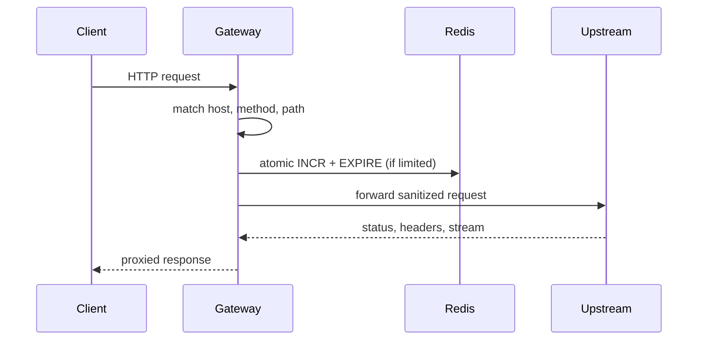
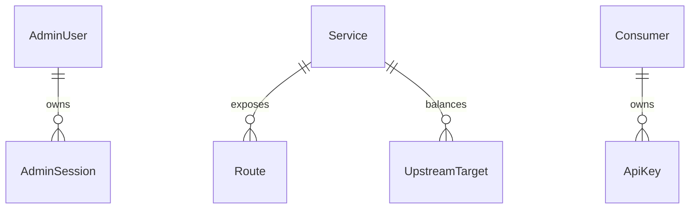

# Architecture

The data plane is a standalone Fastify process. It reads validated route snapshots from the control plane and retains the last valid snapshot after fetch or parse failures. The control plane stores desired configuration in PostgreSQL and publishes versioned snapshots. Redis provides the atomic fixed-window counter. The Next.js dashboard calls the versioned management API.

Current limitations: config refresh uses polling (Redis Pub/Sub is provisioned but gateway subscription is not yet wired); config snapshots are not yet an atomic filesystem/cache artifact; session and policy features are incomplete. See README security notes.
